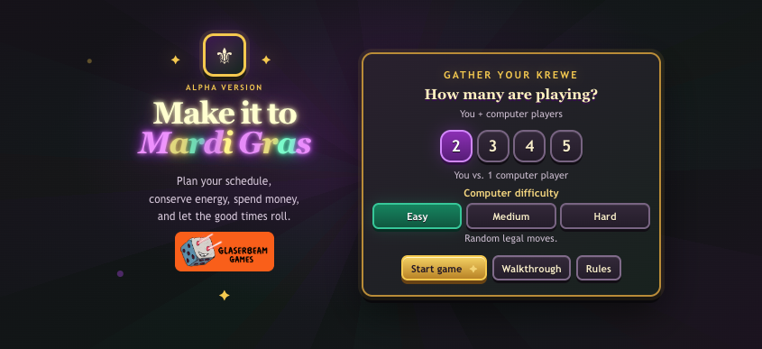
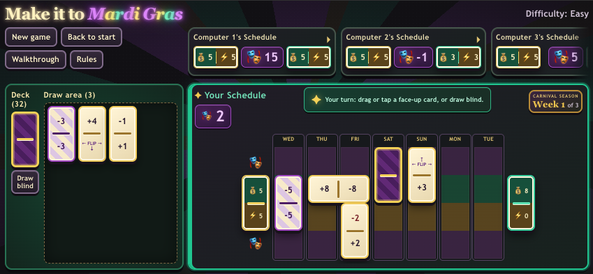

# Make it to Mardi Gras

**Make your plans, mind your energy, and let the good times roll.**

A retro-styled card-game playtest for **2–5 players**: you and up to four computer opponents. Build your schedule over three weeks and finish with the highest final score.

<p align="center">
  
</p>

## At the table



1. **Pick a card** from the draw area, or risk a blind draw from the deck, and place it on your schedule. The first player in week 1 is chosen at random. Drag a card to a highlighted space, or tap a card and then tap a highlighted space. The draw area starts with one more card than the number of players. A playable blind draw is selected automatically and must be placed; the deck shows its top card's back, including positive values on double-negative cards. Blind draws cannot start the next draw; an unplaceable blind card is set aside and the turn is skipped.
2. **Build your week** by overlapping vertical and two-column horizontal cards and balancing carnival points, money, and energy. FLIP counts as zero and turns an adjacent uncovered card over; double-negative cards have opposite positive values on their backs.
3. **Watch for a bust:** if your final money or energy is negative, the first negative column and later columns are grayed out and count as zero. A horizontal card still scores its section before the bust. In week 3, a resource that first goes negative on Mardi Gras Tuesday counts as zero, but Tuesday's carnival points still count and the column is not grayed out. As on every day, only visible values count toward Tuesday's points and resources.
4. **Play three weeks.** Final score is carnival points minus remaining money and energy after busts. Ties go to the most cards touching Tuesday, including covered cards, horizontal cards, and cards in a busted column; remaining ties share the win.

A yellow warning and computer schedule border indicate a possible week-ending play. A computer is also highlighted when its schedule could reach Tuesday with a vertical card from the current week's card types; this is a forward-looking warning, not a prediction of its next move.

Each schedule column scores its **visible** numbers from top to bottom:

| Section | Counts as |
|:---:|:---|
| 1 | Carnival points |
| 2 | Money |
| 3 | Energy |
| 4 | Carnival points |

Card values start in the **1–8** range in week 1, then increase to **2–9** in week 2 and **3–10** in week 3.

New here? Open **Walkthrough** in the app for guided examples, or **Rules** for the complete rulebook.

Card deal, placement, flip, shuffle, and player bust sound effects provide table feedback during play.

## Run locally

Requires Node.js **20.19+ or 22.12+** and npm.

```bash
npm install
npm run dev
```

Open the local URL shown in the terminal.

```bash
npm run build                 # Production build
npm run lint                  # Lint
node --test tests/*.test.mjs  # Game tests
```

## Deploy to Heroku

The app uses Node.js 22 on Heroku. Heroku builds it during deployment and serves the production files using `npm start` on its assigned port.

```bash
heroku login
heroku create make-it-to-mardi-gras
git push heroku main
heroku open
```

For an existing Heroku app, replace `heroku create` with `heroku git:remote -a YOUR_APP_NAME`. App names must be globally unique, and running an app can incur Heroku charges.

## Customize the decks

Edit the three independent card lists in [`src/deck.ts`](src/deck.ts). Weeks 2 and 3 currently use placeholder values.
